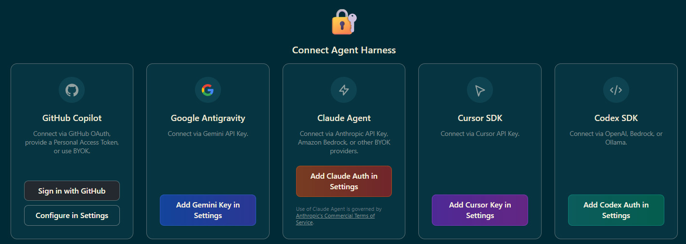
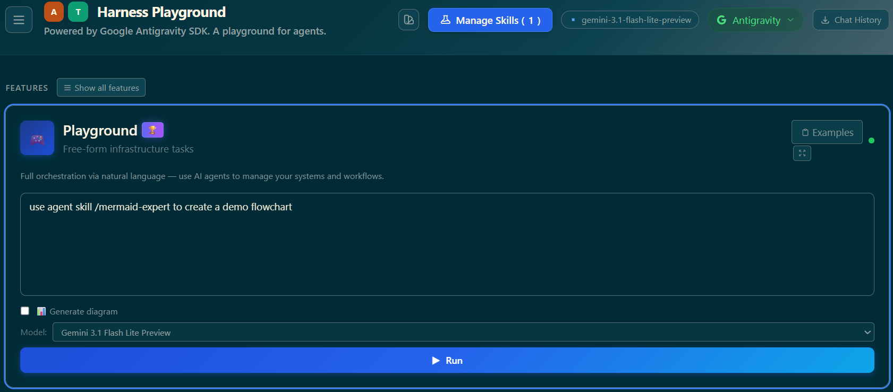
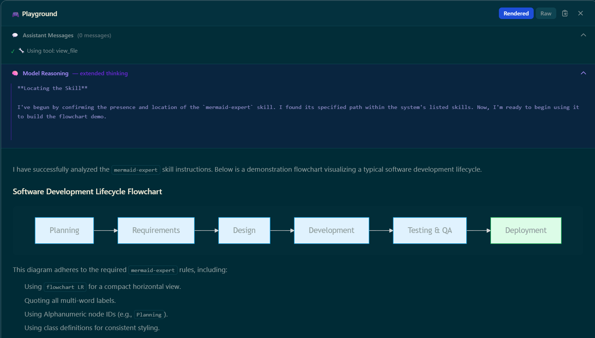

# Harness Playground Template 🚀

*If you found this project useful, please give it a ⭐️ to show your support!*



**Harness Playground Template** is a self-hosted, vendor-agnostic AI Playground template. It gives you a unified, web-based chat interface to orchestrate your local or remote workflows through various popular AI pair programmer SDKs available today: **GitHub Copilot SDK**, **Google Antigravity**, **Cursor SDK**, **Claude Agent SDK**, and **Codex SDK**.

Harness Playground Template is built around your existing subscriptions. If you have a **GitHub Copilot** license, you can connect the Github Copilot SDK. If you subscribe to **Google AI Studio**, you can use Antigravity. If you are a **Cursor Pro** user, connect the Cursor SDK. Have **AWS Bedrock** access or an **Anthropic** account? Connect Claude Agent directly. Already using a **ChatGPT subscription**, **OpenAI**, **AWS Bedrock Mantle** or **Ollama**? Connect Codex. Use what you already pay for!

By wrapping best-in-class agentic SDKs into a single backend, this template lets you seamlessly switch between AI providers without vendor lock-in. You bring your own credentials (BYOK), and the agent securely runs terminal commands, utilizes extensible Agent Skills, reads files, and writes code on your behalf in an ephemeral, isolated environment.

---

## 🌟 Why Harness Playground Template?

This Playground is explicitly designed as a **template** meant to be **cloned, forked, and customized** to perfectly suit your specific organizational needs. It provides a robust, extensible foundation for building specialized AI orchestration tools-for example, it can be easily extended to create highly tailored projects like [Play.Infra](https://github.com/kmarrrahul/Play.Infra). It turns raw programmatic AI SDKs into a unified, secure **web app** that developers and engineers can access directly via their **browser** to orchestrate complex workflows using simple **natural language**. Refer to this section for more ideas: [Specialized Playground Ideas](#-inspiration-specialized-playground-ideas).

- **Multi-Harness Evaluation:** Choose between your favorite harness: GitHub Copilot, Claude Agent, Antigravity, Codex, and Cursor directly in the UI, with easy login and setup. Authenticate using PATs, OAuth, or API keys from supported LLM providers (BYOK).
- **Connect & Verify Instantly:** Securely plug in your GitHub tokens or custom authentication credentials directly through the UI. You can instantly test these connections with a single click to ensure the agent has the exact access it needs before launching any workflows.
- **Agentic Autonomy Without the Complexity:** Harness Playground Template empowers LLMs to directly utilize the super fast CLI and terminal tools you already trust (`python`, `npm`) by dynamically injecting their required configurations. It also supports expanding those capabilities instantly via widely supported **Agent Skills**.
- **Bring Your Own Keys (BYOK):** Don't pay for additional AI subscriptions. The template connects directly to AWS Bedrock, Anthropic Console, Google AI Studio, or GitHub using your existing API keys and corporate billing.
- **Security & Isolation:** Credentials are provided directly via your browser session and are never permanently stored on the server. For each execution, the backend generates a unique, ephemeral directory to securely write your session's tokens, and injects them as strict environment paths into the agent's isolated environment. Once the task completes, the temporary credentials are automatically destroyed.

---

## 🤖 Supported SDKs

This generic template abstracts the complexity of individual SDKs to provide a unified streaming UI for:

- **[GitHub Copilot SDK](https://github.com/github/copilot-sdk)**: The official GitHub Copilot SDK. Personal and Enterprise accounts.
- **[Google Antigravity SDK](https://github.com/google-antigravity/antigravity-sdk-python)**: Google's official advanced agentic coding assistant designed for complex, multi-step workflows.
- **[Cursor SDK](https://cursor.com/docs/sdk/python)**: Connect via the Cursor's Official Python SDK.
- **[Claude Agent SDK](https://code.claude.com/docs/en/agent-sdk/overview)**: Powered by Anthropic's official Agent SDK. Supports standard Anthropic API keys OR Amazon Bedrock BYOK (bring your own AWS credentials) via environmental injection.
- **[Codex SDK](https://developers.openai.com/codex/)**: Official OpenAI Codex SDK. Allows native connection via ChatGPT subscriptions, OpenAI API keys, AWS Bedrock, and local Ollama servers.

---

## 🛠️ Core Capabilities

As a customizable template, it serves as a powerful foundational chatbot and orchestrator that uses terminal commands, Agent Skills, and MCPs for resolving issues and collecting data. You can fork it to add your own pre-built workflows, while leveraging the flagship **Playground** for free-form management.




### 🧩 Extensible Agent Skills
The template natively supports **Agent Skills**, allowing you to instantly expand what the AI can do without writing code. 
- **Bundled Skills:** The app comes pre-bundled with a `/mermaid` skill, empowering the agent to dynamically produce technical Mermaid diagrams (flowcharts, architecture maps, etc.) based on the live resources it analyzes.
- **Upload Your Own:** Easily upload and manage your own custom skills directly through the UI to tailor the agent to your specific organizational needs and internal CLI tools.

### 🔌 Seamless Connectivity
Effortlessly link your development environments and repositories directly from the UI sidebar. By providing a GitHub PAT, GitHub is natively integrated into the app-giving the agent direct access to read your repositories, deeply understand your codebase, and analyze your GitHub Actions deployments. Built-in "Test Connection" buttons verify access instantly, ensuring the agent is ready to execute scripts on your behalf.

### 📊 Interactive Mermaid Diagrams
The app renders Mermaid diagrams embedded in Markdown directly in the chat UI. By scanning your codebase or live application environments, the agent can instantly generate architectural maps, logic flowcharts, and dependency diagrams. This helps understand complex dependencies, verify that designs match the intended architecture, and other documentations.

### 📝 Prompt Templates
The template includes a built-in **Prompt Templates** engine. Once you clone the repository, you can hardcode and customize reusable prompt blueprints in the source code to establish best practices, standardize generation, and save time on repeated tasks for your team.

---

## 💡 Real-World Use Cases

Because the template injects your credentials into a secure, isolated shell session, the AI can perform complex, cross-domain troubleshooting that would normally take hours:

- **Cross-Platform Root Cause Analysis:** Bring your GitHub PAT. If an application is failing in CI/CD, simply ask the agent to *"investigate the latest failed GitHub Action run and correlate the error with the source code in the repository."* The agent will parse the stack trace, clone or search the repo using `gh`, pinpoint the exact line of code causing the failure, and even submit a Pull Request.
- **Autonomous Bug Fixing:** Ask the agent to *"debug and fix the memory leak in the `frontend-app` which is crashing on startup."* The agent will pull local execution events, analyze the console logs, identify the misconfiguration, and apply the fix.
- **Code Quality Audits:** Ask the agent to *"find all database queries without pagination and generate the code required to fix them."* The agent will scan your local workspace and output ready-to-commit files.
- **Seamless Investigations:** Instead of clicking through your IDE, GitHub, and your terminal, you have one chat interface with access to everything simultaneously. It’s incredibly convenient for correlating a recent GitHub pull request to a local test failure.

---

## 💡 Inspiration: Specialized Playground Ideas

Because this project is a foundational template, you can easily fork it to build highly tailored AI tools that orchestrate specific engineering domains using **natural language**. Here are some practical ideas of what you could build by bundling the right MCPs, CLIs, and Agent Skills:

### 1. Play.NetSec (Network Security & Zero Trust)
- **Core Idea:** A playground for network security engineers to audit firewalls, troubleshoot VPN connectivity, and validate zero-trust policies autonomously.
- **MCPs/CLIs:** Cloudflare MCP, `nmap`, `dig`, `traceroute`, `tcpdump`.
- **Custom Skills:** `/audit-fw` (audits firewall rules for overly permissive ports), `/trace-path` (diagrams the exact network path and security layers between two nodes).

### 2. Play.MLOps (Production Lifecycle Guard)
- **Core Idea:** An platform that manages the entire production lifecycle of a model. Monitor live data for quality drift, evaluates new model candidates in a shadow environment, and safely swaps production models only when they outperform the baseline.
- **MCPs/CLIs:** GitHub MCP, PostgreSQL MCP, `dvc`, `mlflow`, `kserve`, `evidently`.
- **Custom Skills:** `/lineage-drift` (detects upstream feature drift and auto-triggers retraining loops in MLflow), `/safe-deploy` (monitors real-time prediction variance in shadow routes and auto-promotes models via KServe).

### 3. Play.DBA (Database Administration)
- **Core Idea:** A playground for Database Administrators to analyze slow queries, manage schemas, and optimize database performance securely.
- **MCPs/CLIs:** PostgreSQL/MySQL Schema MCP, `psql`, `pg_dump`, `mysql`, `pt-query-digest`.
- **Custom Skills:** `/explain`, (runs EXPLAIN on a query and visually maps the execution plan, any mermaid gets automatically rendered in the UI), `/index-advisor` (suggests missing indexes based on query logs).

### 4. Play.ProjectOps (Issue Tracking & Knowledge Base)
- **Core Idea:** A playground for product managers and agile leads to autonomously groom backlogs, cross-reference tickets with wiki documentation, and generate sprint summaries.
- **MCPs/CLIs:** Jira MCP, Jira Xray MCP, Confluence MCP.
- **Custom Skills:** `/groom-backlog` (identifies stale tickets and cross-references them against recent documentation updates), `/test-coverage` (analyzes Jira Xray test execution reports against current active sprints).

### 5. Play.APITesting (API Quality & Mocking)
- **Core Idea:** A playground for QA and backend engineers to automatically generate test suites, mock endpoints, and validate REST/GraphQL schemas.
- **MCPs/CLIs:** Postman MCP, Swagger MCP, `curl`, `bruno`, `newman`.
- **Custom Skills:** `/gen-tests` (scaffolds a complete Bruno test suite from an OpenAPI spec), `/mock-server` (spins up a local Node server mocking a specific endpoint response).

### 6. Play.IoT (Hardware & Device Telemetry)
- **Core Idea:** A playground for IoT engineers to monitor fleet telemetry, debug firmware over-the-air (OTA) updates, and query edge device logs.
- **MCPs/CLIs:** AWS IoT Core MCP, `mqtt`, `arduino-cli`, `esptool`.
- **Custom Skills:** `/fleet-health` (aggregates battery/connectivity metrics across devices), `/debug-ota` (analyzes firmware crash dumps from edge nodes).

### 7. Play.SecOps (Vulnerability Remediation)
- **Core Idea:** An autonomous security operations center (SOC) playground that triages CVEs, scans codebases, and automatically authors patches for vulnerabilities.
- **MCPs/CLIs:** Snyk MCP, JFrog Xray MCP, `trivy`, `semgrep`.
- **Custom Skills:** `/triage-cve` (cross-references a CVE against the codebase to find impact), `/auto-patch` (generates and applies a security fix for a vulnerable dependency).

### 8. Play.DataEng (Pipeline Orchestration)
- **Core Idea:** A playground for data engineers to debug broken DAGs, backfill data, and query data warehouses without switching between Airflow UI and Snowflake worksheets.
- **MCPs/CLIs:** Snowflake MCP, BigQuery MCP, `dbt`, `astro` (Astronomer CLI), `aws s3`.
- **Custom Skills:** `/debug-dag` (analyzes Airflow logs to find why a task failed), `/data-lineage` (generates a Mermaid flowchart of dbt models upstream/downstream).

---

## 🔌 Bruno API Collections

A [Bruno](https://www.usebruno.com/) collection is provided in the `bruno/` directory to help you test backend endpoints (`/api/run`, `/api/models`, etc.) locally. Simply import the collection and configure your environment variables to start testing.

---

## 🛣️ API Routes

| Method | Path | Description |
|--------|------|-------------|
| `GET`  | `/` | Main UI (Jinja2 rendered) |
| `GET`  | `/api/health` | Service health check |
| `GET`  | `/api/models` | Live list of available models for the selected provider |
| `POST` | `/api/run` | Start an agentic task - returns an SSE stream |
| `POST` | `/api/followup` | Send follow-up to an active session - returns an SSE stream |
| `GET`  | `/api/oauth/login` | Begin GitHub OAuth flow |


## 🚀 Quick Start (Local Development)

```bash
git clone https://github.com/kmarrrahul/harness-playground-template.git
cd harness-playground-template
pip install -r requirements.txt

# Run the Uvicorn server
python -m uvicorn app.main:app --port 8080 --reload
```

Open `http://localhost:8080`, select your preferred AI provider, plug in your API key, and start orchestrating your tasks! Since this is a template, feel free to fork the repository and start modifying the source code to add your own UI branding, domain-specific Prompt Templates, and backend logic.

---

## 🐳 Docker Deployment

### Build
```powershell
.\build_and_push.ps1 -Tag 1.0.4
```
The Dockerfile bundles Python 3.11, Node.js 20, GitHub Copilot CLI, gh CLI, and uv.

### Run

To ensure `localhost` resolves flawlessly for GitHub OAuth callbacks (especially on Windows Docker Desktop), explicitly bind both the IPv4 and IPv6 loopbacks:

```powershell
docker run -it --name harness-playground `
  -p 127.0.0.1:8080:8080 -p "[::1]:8080:8080" `
  -e COPILOT_MODEL=claude-haiku-4.5 `
  registry.example.com/myproject/harness-playground:0.0.1
```

> **Note:** If you want to enable the "Sign in with GitHub" OAuth flow specifically for the GitHub Copilot SDK, simply append `-e GITHUB_OAUTH_CLIENT_ID=$env:GITHUB_OAUTH_CLIENT_ID -e GITHUB_OAUTH_CLIENT_SECRET=$env:GITHUB_OAUTH_CLIENT_SECRET` to the command above.

### Selective Image Builds (Optimizing Size)

The final Docker image bundles native agent runtimes (like Go daemons or Node binaries) via Python SDK `site-packages`, as well as heavy infrastructure binaries, resulting in a default image size of ~1.5 GB. If you only intend to use specific AI Harness SDK's or binaries, you can dramatically reduce the image size (down to ~400 MB) by using Docker build arguments:

```bash
# Example: Build an image containing ONLY the Cursor SDK and gh
docker build -t harness-playground:antigravity-only \
  --build-arg ENABLE_COPILOT=false --build-arg ENABLE_CLAUDE=false --build-arg ENABLE_CURSOR=false --build-arg ENABLE_CODEX=false \
  .
```

Available SDK build arguments (default `true`):
- ENABLE_COPILOT, ENABLE_CLAUDE, ENABLE_CURSOR, ENABLE_ANTIGRAVITY, ENABLE_CODEX

Available Binary build arguments (default `true`):
- ENABLE_GH

### Using helper Script:

> **Pre-built Images**: You can find ready-to-use Docker images for all configurations at [kmarrrahul/harness-playground-template on DockerHub](https://hub.docker.com/r/kmarrrahul/harness-playground-template).
To build a lightweight image with only Github Copilot SDK Integration, you can run:
```powershell
.\build_and_push.ps1 -EnableClaude $false -EnableCursor $false -EnableAntigravity $false -EnableCodex $false -EnableGh $false
```
Use available params to build image as needed.
- Available params: EnableCopilot, EnableClaude, EnableCursor, EnableAntigravity, EnableCodex, EnableGh

---

## ☸️ Kubernetes Deployment

Harness Playground Template is fully prepared for multi-tenant production deployments on Kubernetes.

```bash
kubectl apply -f k8s/harness-playground-credentials-secret.yaml
kubectl apply -f k8s/deployment.yaml
kubectl apply -f k8s/service.yaml
kubectl apply -f k8s/ingress.yaml
```

Once deployed, the app will be accessible at your cluster's ingress URL.

---

## 🤝 Contributing

We'd love your help in making this template even better! Please read our [Contributing Guidelines](CONTRIBUTING.md) to learn about our development process, how to propose bug fixes and improvements, and how to build and test your changes locally.
