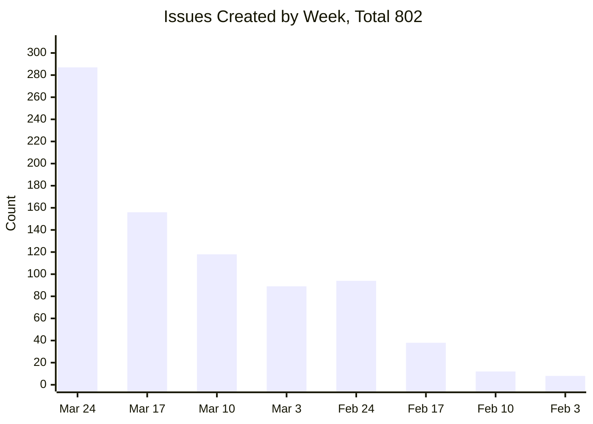
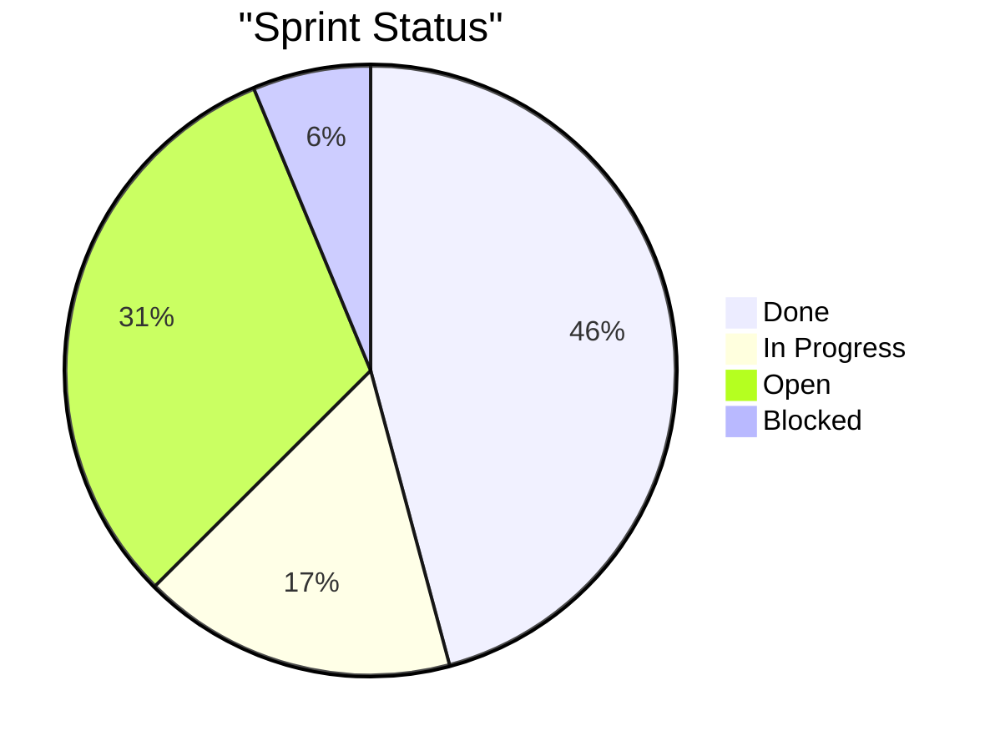
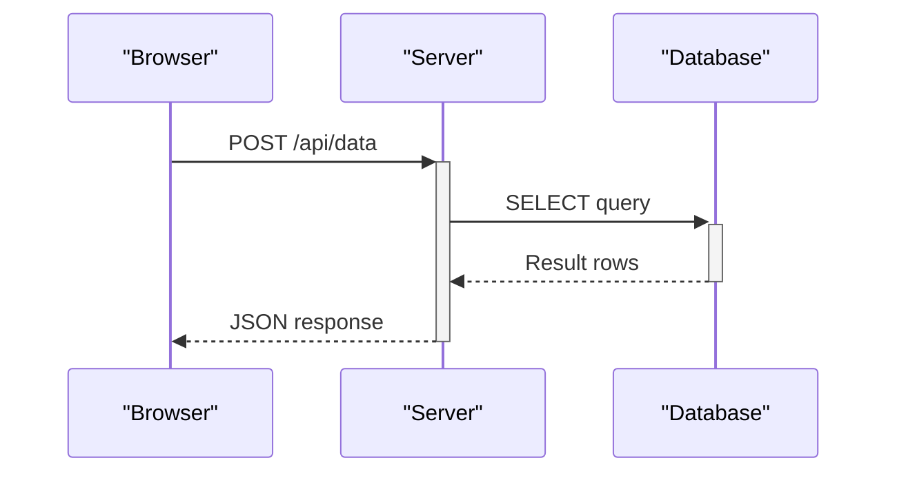
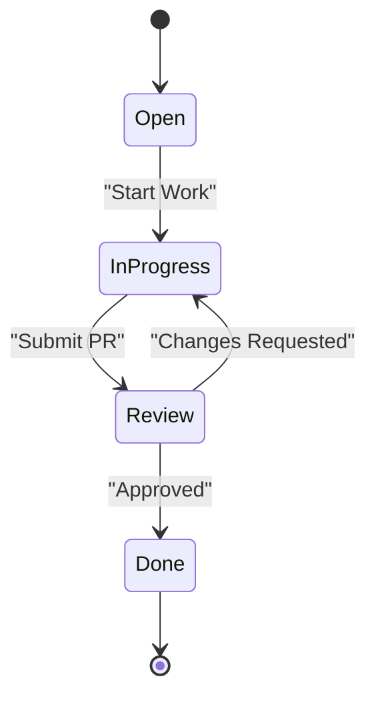
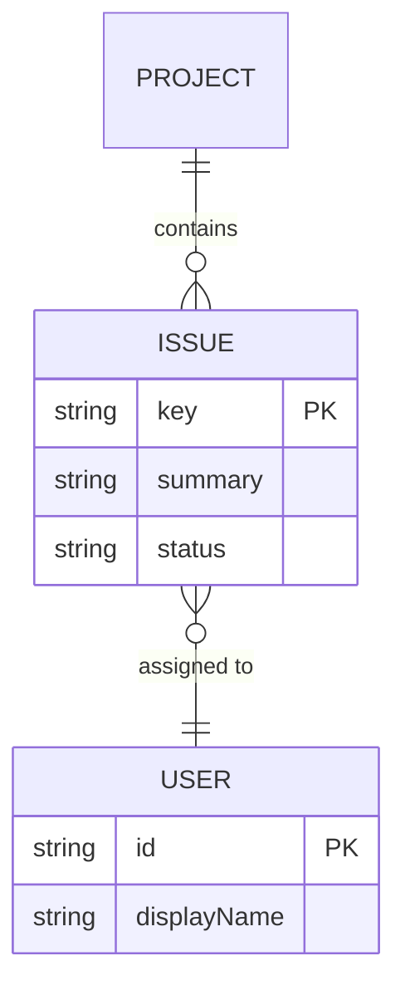

## Use this skill when

- The user asks for a diagram, chart, or visual representation
- Data should be visualized as a bar chart, pie chart, timeline, or trend line
- Documenting flows, architectures, state machines, or entity relationships

## Do not use this skill when

- The user explicitly says "no diagram" or "text only"

---

## Instructions

You are a Mermaid diagram expert. Every diagram you produce MUST render
without errors. You may use **any** Mermaid diagram type (flowchart, pie,
xychart-beta, sequenceDiagram, stateDiagram-v2, erDiagram, classDiagram,
gantt, journey, gitGraph, mindmap, timeline, quadrantChart, sankey, kanban,
block, architecture, radar, etc.) — pick whatever best fits the data.

### Output format

- Wrap each diagram in a fenced code block with language `mermaid`
- You may generate **multiple diagrams** if the data warrants it
- Place diagrams at the END of your response, after the textual analysis

---

## Chart-Type Selection Guide

| Data shape | Mermaid keyword |
|---|---|
| Counts over time or by category | `xychart-beta` (bar/line) |
| Trend lines, velocity, burndown | `xychart-beta` with `line` |
| Proportional splits (% open vs closed) | `pie` |
| Process flows, pipelines, board columns | `flowchart LR` (preferred) |
| API call sequences, request/response | `sequenceDiagram` |
| Database schemas, entity relations | `erDiagram` |
| Lifecycle states, transitions | `stateDiagram-v2` |
| Schedules, sprint timelines | `gantt` |
| Object models, class hierarchies | `classDiagram` |
| User experience steps | `journey` |

**Rule:** Do NOT use flowchart for numerical counts — use `xychart-beta`.

---

## Critical Syntax Rules

Violations cause **lexical errors** and render failures.

### The #1 Rule: ALWAYS QUOTE multi-word text

Mermaid's parser treats unquoted multi-word text as separate tokens, causing
"Lexical error / Unrecognized text". **If in doubt, wrap it in double quotes.**

This applies everywhere: `title`, `x-axis`/`y-axis` labels, node labels,
subgraph titles, pie slice labels — any text with spaces or special characters.

### Forbidden characters in titles and labels

Never use these **unescaped** in any title, label, or axis text:
- Parentheses: `(` `)`
- Colons: `:`
- Semicolons: `;`
- Standalone hyphens surrounded by spaces: ` - `
- Ampersands, angle brackets: `&` `<` `>`
- Curly braces in comments: `{}` (gets parsed as a directive)

**Fix:** Rephrase, remove, or replace with commas. Always quote the full string.

### Universal rules (all diagram types)

- **Quote ALL multi-word text** in double quotes `"..."`
- Node IDs: **alphanumeric only** — no hyphens, dots, or spaces
- Node labels: always `nodeId["Label text"]` — never `nodeId(Label)`
- The word `end` alone breaks flowcharts — wrap in quotes: `"End"`
- Indent nested content with **4 spaces** (not 2, not tabs)
- Use `%%` for comments — never `{}` inside comments

---

## Diagram Syntax and Examples

### Flowchart

- **ALWAYS prefer `flowchart LR`** (horizontal) — it is more compact and readable
- Only use `flowchart TD` when the data is truly hierarchical (org charts, trees)
- Styles: `classDef name fill:COLOR,stroke:COLOR,color:#fff` + `:::name`
- Arrows: `-->` solid, `-.->` dashed, `==>` thick
- Subgraphs: `subgraph "Title"` ... `end`


### xychart-beta (bar and line charts)

- `title` MUST be quoted if multi-word: `title "My Title"`
- `x-axis` labels MUST each be quoted: `["Week 1", "Week 2"]`
- **x-axis labels must be SHORT** — abbreviate dates, remove parentheses
- `y-axis` range: `"Label" min --> max`
- `bar [...]` / `line [...]`: plain numbers, count MUST match x-axis labels
- **ONE bar + ONE line maximum** — you CANNOT have multiple bar/line datasets.
  Do NOT try: `bar [...], "Label" line [...]` — this causes a parse error.
  If you need multiple datasets, create **separate diagrams**.
- Indent with **4 spaces**

BAD (lexical errors — parentheses + long labels):
```
xychart-beta
    title "Issues Created by Week, Total: 802"
    x-axis [Week 0 (Mar24-26), Week 1 (Mar17-23), Week 2 (Mar10-16)]
    y-axis "Count" 0 --> 310
    bar [287, 156, 118]
```

BAD (multiple datasets — parse error):
```
xychart-beta
    title "Trend"
    x-axis ["W1", "W2"]
    bar [5, 8], "Label" line [3, 6]
```

GOOD:


### Pie chart

- `pie title "Title"` — title MUST be quoted if multi-word
- Each slice: `"Label" : number` — label MUST be quoted, value is raw number



Note: Pie charts have built-in colors. No custom styling needed.

### Sequence diagram

- Participants: `participant Alias as "Display Name"`
- Arrows: `->>` solid, `-->>` dashed, `-x` lost, `-)` async
- Lifelines: `activate`/`deactivate` or `+`/`-`
- Grouping: `alt`/`else`/`end`, `loop`/`end`, `Note over A,B: text`



### State diagram

- Start/end: `[*]`
- Transitions: `StateA --> StateB : trigger`



### Entity Relationship Diagram

- Cardinality: `||` one, `o|` zero/one, `}|` one+, `}o` zero+
- Keys: `PK`, `FK`, `UK`



---

## Styling Guide

- Apply colors **meaningfully** — convey status or category, not decoration, avoid dark colors
- Use **visually distinct** colors so nodes with different meanings are easy to tell apart
- Ensure **sufficient contrast** between fill and text colors
- Assign colors **semantically**: warmer tones for risk/blockers, cooler tones for active work, positive tones for done/success
- For Flowchart diagrams **ALWAYS use `flowchart LR`** unless data is truly hierarchical — horizontal saves space
- Limit nodes to **15 per diagram** — split into multiples if needed
- Keep labels short — abbreviate where possible

---

## Common Pitfalls

| Mistake | Fix |
|---|---|
| Unquoted multi-word title | `title "My Chart Title"` |
| Unquoted x-axis labels | `["Week 1", "Week 2"]` |
| `()` in labels: `Week 0 (Mar24)` | Remove parens: `"Mar 24"` |
| Long x-axis labels | Abbreviate: `"Mar 24"` not `"Week 0 (Mar24-26)"` |
| Multiple bar/line datasets | ONE bar + ONE line max per chart. Use separate diagrams |
| Hyphen in title: `A - B` | Comma: `"A, B"` |
| `:` or `;` in text | Remove or rephrase |
| Hyphens in node IDs | Use camelCase: `myNode` |
| `node(label)` | Use `node["label"]` |
| `{}` in comments | Plain `%%` only |
| `end` as a label | Wrap: `"End"` |
| 2-space indent in xychart | Always 4-space indent |
| Mismatched bar count vs x-axis | Must be equal |
| `flowchart TD` for workflows | Use `flowchart LR` — horizontal is more compact |
| `>15` nodes | Split into multiple diagrams |